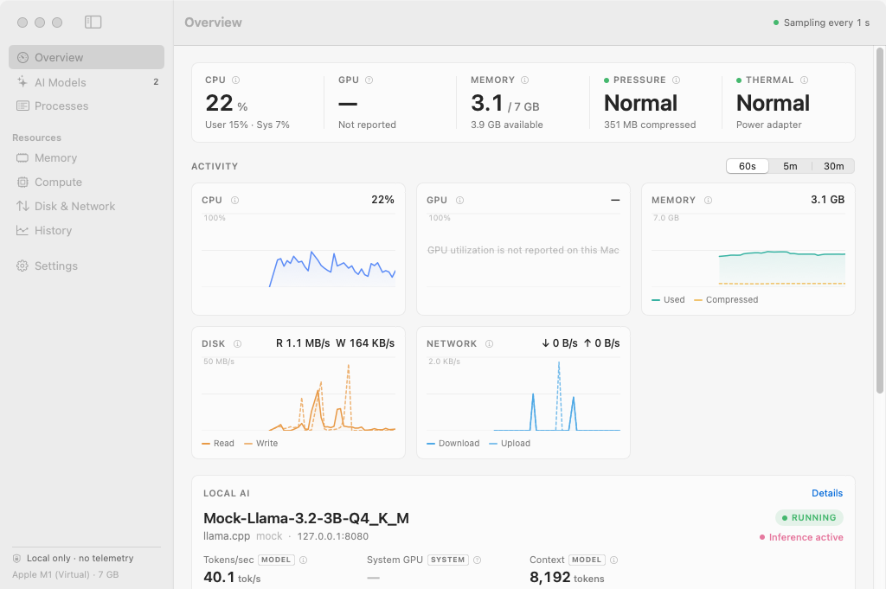
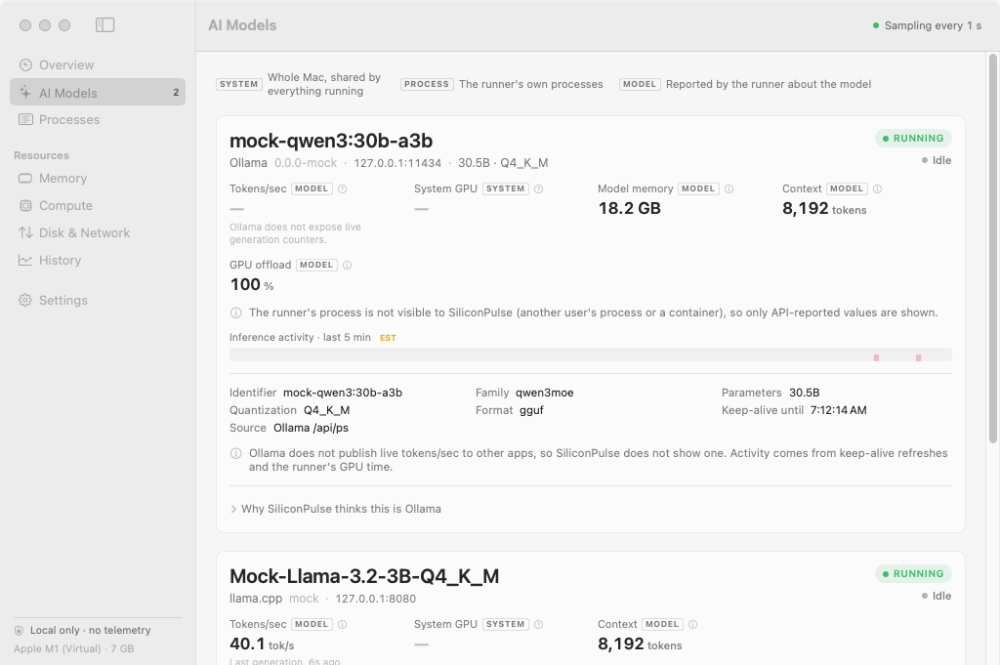
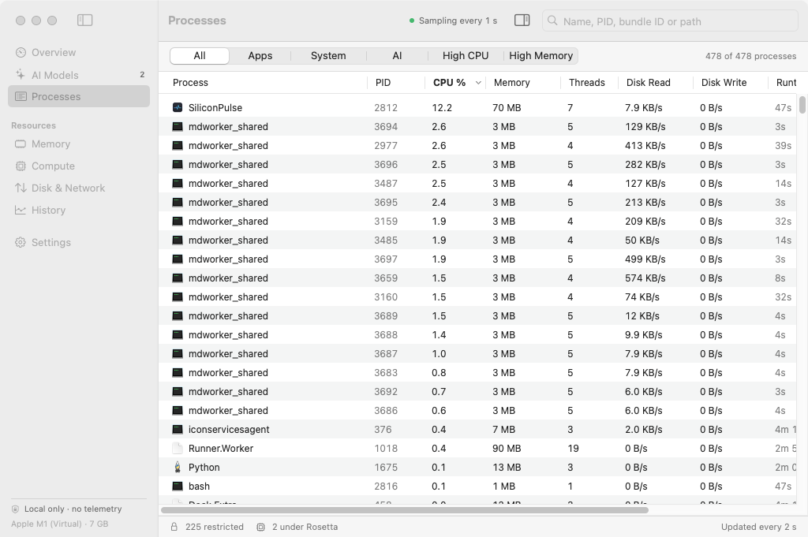
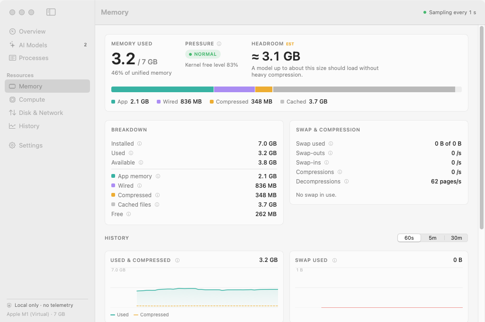
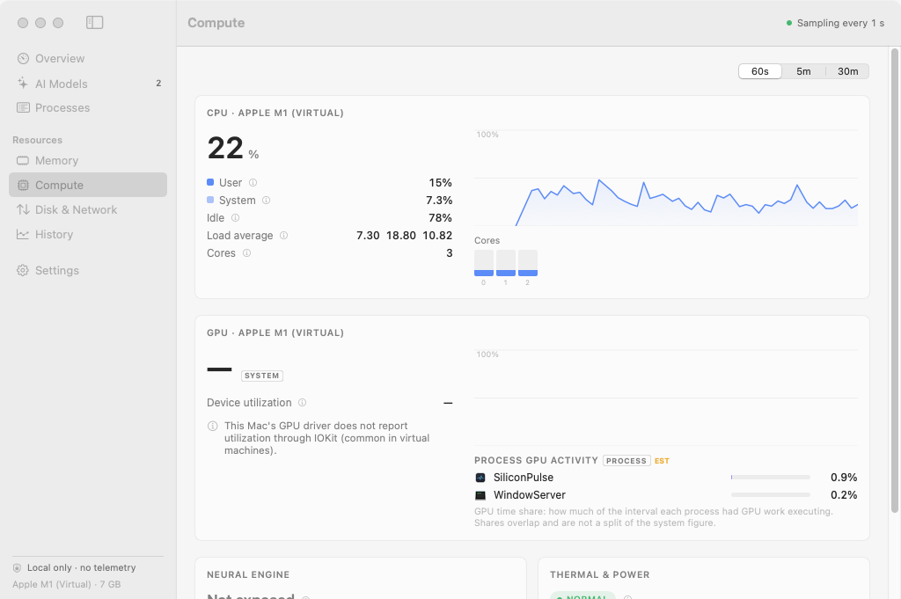
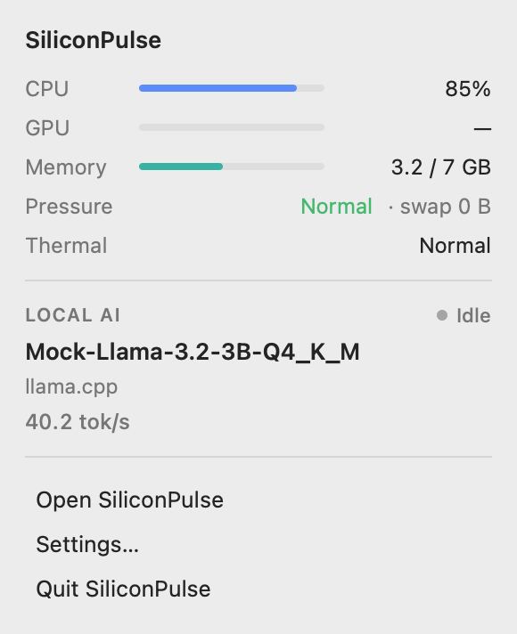

<div align="center">

# 〰 SiliconPulse

**See what your Mac is really doing.**

A lightweight, native macOS monitor for Apple Silicon and local AI workloads.
Swift + SwiftUI. No Electron, no web views, no telemetry.

</div>

---

SiliconPulse answers, at a glance:

- What is using my Mac right now?
- Is my local model actually using the GPU?
- How much unified memory is in use, and is macOS compressing or swapping?
- What model is loaded, in which runner, and is it generating right now?
- Is the Mac thermally constrained?

It shows only what macOS (or the runner itself) actually exposes. Every value has a quality class (**exact**, **reported**, **calculated**, **estimated** or **unavailable**). Measured values stay clean, and hovering any value shows its source and class. Estimated values are marked *Estimated* on screen, and unavailable ones show a dash and the reason. When macOS does not expose something, SiliconPulse says so instead of inventing a number.

## Screenshots

These screenshots come from SiliconPulse's own `--profile` mode on a GitHub Actions macOS runner. That runner is an Apple M1 *virtual machine*, so there is no GPU utilization (the paravirtual GPU does not report it) and its CPU is busy with CI work. The local AI workloads shown are `scripts/mock-runners.py`, a test-only mock of the Ollama and llama-server APIs (the model names say "mock"), not real runners.

| Overview | AI Models |
|---|---|
|  |  |
| **Processes** | **Memory** |
|  |  |
| **Compute** | **Menu bar popover** |
|  |  |

## Features

- **Overview**: CPU, GPU, memory, memory pressure and thermal/power state as large numbers; live charts for CPU, GPU, memory, disk and network (60 s / 5 min / 30 min); the detected local AI workload; top CPU and memory consumers.
- **AI Models**: every detected runner with loaded models, model metadata, context length, runner-reported model memory and GPU offload, runner process CPU/memory/GPU time, tokens/sec where the runner exposes it, an inference-activity timeline, and the evidence behind each detection.
- **Processes**: searchable, sortable table (process, PID, CPU, memory, threads, disk read/write, runtime, architecture, user) with All / Apps / System / AI / High CPU / High Memory filters. Selecting a process opens an inspector with CPU and memory history, executable, arguments, working directory, open files, parent, children and listening TCP sockets. The inspector collects this only for the selected process.
- **Memory**: installed, used, available, app, wired, compressed, cached, free, swap, live swap-in/out and compression rates, memory pressure, and an estimated headroom for loading another model.
- **Compute**: CPU total/user/system/idle, load average, per-core bars grouped into performance and efficiency clusters (when the device tree confirms the layout), system GPU utilization with renderer/tiler and GPU memory, per-process GPU time share, Neural Engine status, thermal and power.
- **Disk & Network**: system read/write and download/upload with history, top disk consumers, per-interface throughput.
- **History**: bounded in-memory history of every charted metric, with average and peak per window.
- **Menu bar**: configurable title such as `CPU 22% · GPU 91% · RAM 21.8G`, or `Qwen3 · GPU 91% · 38 tok/s` while a model is loaded. Clicking it opens a compact popover. The window can be closed while the menu bar item keeps running.
- **Diagnostics** (Settings): SiliconPulse's own CPU and memory, the number of sampling loops running (always 1), the live schedule, and the measured CPU cost of every collector.

## Local AI monitoring

Detection is evidence-based: a process name alone only makes something a *candidate*, and the runner's own API, its listening ports or its launch arguments confirm it. Every HTTP request goes to `127.0.0.1` only, and the HTTP client refuses any other host.

| Runner | Detected from | Loaded model | Context | Model memory / GPU offload | Tokens/sec | Inference activity |
|---|---|---|---|---|---|---|
| **Ollama** | `ollama serve` + runner children, `OLLAMA_HOST`, `GET /api/ps` | ✅ `/api/ps` | ✅ | ✅ size / `size_vram` | ❌ not exposed by Ollama | keep-alive refresh, runner GPU time |
| **LM Studio** | LM Studio app/helpers/`llmster`, `GET /api/v1/models` or `/api/v0/models` | ✅ | ✅ | size (v1 API) | ❌ not exposed by LM Studio | runner GPU time |
| **llama.cpp** (`llama-server`) | process + `--port`, `GET /props`, `/slots`, `/metrics` | ✅ | ✅ | `-ngl` layers | ✅ from `/metrics` (`--metrics`) or `/slots` | ✅ slot `is_processing` |
| **llama.cpp CLI** (`llama-cli` …) | process + arguments | ✅ from `-m` / `-hf` | ✅ `-c` | `-ngl` | ❌ | process CPU/GPU |
| **MLX / mlx-lm / mlx-vlm** | Python processes running `mlx_lm.*` | ✅ from `--model` | — | — | ❌ | runner GPU time |
| **Python inference** (transformers, vLLM, diffusers, llama-cpp-python …) | command-line keywords | from `--model` | — | — | ❌ | process CPU/GPU |
| **OpenAI-compatible servers** | candidate listening ports or custom endpoints, `GET /v1/models` | ✅ | — | — | ❌ | process CPU/GPU |

Values carry their **scope**:

- **SYSTEM**: the whole Mac (for example, GPU 87% is the system GPU, shared by everything).
- **PROCESS**: the runner's own process tree (CPU, footprint, GPU time share).
- **MODEL**: what the runner reports about the model (size, context, GPU offload, tokens/sec).

System GPU utilization is never attributed to a model.

## Privacy

SiliconPulse is local-only. It has no analytics, telemetry, accounts, cloud backend, tracking or advertising SDKs, and it uploads nothing. Its only network traffic is HTTP to AI runners on `127.0.0.1`. History lives in memory and is discarded when you quit; there is no database.

## System requirements

- macOS 14 Sonoma or later
- Apple Silicon recommended. It runs on Intel Macs, but P/E core and per-process GPU features are Apple Silicon specific.
- To build: Xcode 16 or later (Swift 5.10+ toolchain)

## Build

```bash
git clone https://github.com/kingnazz/SiliconPulse-.git
cd SiliconPulse-
scripts/build-app.sh          # release build → build/SiliconPulse.app (ad-hoc signed)
open build/SiliconPulse.app
```

Development:

```bash
swift build                  # debug build
swift run SiliconPulse       # run without bundling
swift test                   # core + macOS collector tests
scripts/profile-app.sh build/SiliconPulse.app profile   # scripted self-profile + screenshots
```

The platform-independent core (`SiliconPulseCore`) also builds and tests on Linux (`swift test`), which CI does as well.

## Architecture

```
Sources/
  SiliconPulseCore/        Pure Swift + Foundation, no OS calls, fully unit tested
    Models/                Snapshots, MetricQuality, MetricCatalog (tooltips), SamplingPolicy, diagnostics
    Metrics/               CPU tick math, memory breakdown, counter rates, IOKit string parsing, GPU-time shares
    History/               Ring buffers and 60 s / 5 min / 30 min multi-resolution series
    Processes/             Process table query/sort/filter, process tree, KERN_PROCARGS2 parser
    AIProviders/           Ollama, LM Studio, llama.cpp, MLX and generic providers, AIMonitor actor,
                           throughput tracking, loopback-only HTTP client
  SiliconPulseSystem/      macOS collectors (Mach, sysctl, libproc, IOKit, IOPowerSources)
                           owned by the SystemSampler actor, which also times each collector
  SiliconPulse/            SwiftUI app
    Engine/                MonitorEngine (the single sampling loop), settings, window visibility, profiler
    DesignSystem/          Theme, components, Canvas-based charts
    Features/              Overview, AI, Processes, Memory, Compute, DiskNetwork, History, Settings, MenuBar, Onboarding
```

**Sampling.** One `MonitorEngine` loop runs every tier: system (CPU, GPU, memory, disk, network, thermal), processes, AI discovery and slow (power). It sleeps until the next tier is due and wakes early when demand rises. Views never own timers. Changing screens or opening and closing windows only changes *demand*, so no duplicate loops can appear; Settings → Diagnostics shows the loop count, and the CI profile asserts it.

| | Window visible | Popover open | Hidden (menu bar only) |
|---|---|---|---|
| System metrics | setting (0.5 / 1 / 2 / 5 s, default 1 s) | setting | ≥ 2 s (5 s if the menu bar shows no values) |
| Process table | max(setting, 2 s) on screens that show processes | ≥ 2 s | 5 s |
| AI discovery | 2 s on AI Models, else 5 s | 5 s | 10 s |
| Power source | 10 s | 10 s | 30 s |

Low Power Mode doubles every interval. Process static info (path, user, architecture) and launch arguments are cached per PID and start time, and the process-list buffer is reused between samples. AI detection runs on its own actor, so a slow or dead local API can never stall system sampling or the UI.

**History.** Each metric keeps three ring buffers of 120 points (0.5 s, 2.5 s and 15 s buckets), so memory is constant no matter how long SiliconPulse runs.

See [docs/METRICS.md](docs/METRICS.md) for every metric's collection method, accuracy class, cost, permissions and fallback.

## Measured performance

Every CI run builds the release app and drives it through a scripted session (`--profile`): dashboard visible, every screen, the window closed, ten rapid open/close cycles, then an 8-minute soak. SiliconPulse's own CPU time and footprint come from the kernel's accounting for the process (`getrusage`, `task_info` `phys_footprint`), cross-checked with `ps`. Ranges below span the last two CI runs (`profile` artifact):

| State | Average CPU (% of one core) | Footprint |
|---|---|---|
| Window closed, menu bar only (soak, 4 × 1 min) | 0.37–0.68% | 67.7–68.3 MB, flat |
| Overview visible, 1 s sampling (soak, 4 × 1 min) | 2.8–4.7% | 68.1–68.7 MB, flat |
| AI Models visible | 1.6–3.6% | ≈ 65 MB |
| Processes visible (≈ 500-row table) | 8.7–11.6% | ≈ 74 MB |
| 10 × open/close of the main window | ≈ 15% during the cycling | +5 MB, then stable |

The sampling loop count stays at exactly 1 throughout, including the open/close cycles. Collector costs, in thread CPU per run: CPU 0.1 ms, memory 0.05 ms, GPU 0.3 ms, disk 0.3 ms, network 0.15 ms, process table (≈ 500 processes) 2.4–3.2 ms, per-process GPU accounting 1.3–1.8 ms, AI candidate inspection 0.3 ms (plus localhost API calls, run off the main thread every 5–10 s).

**Caveat:** these numbers come from a GitHub-hosted *virtual* M1 with 3 vCPUs and no GPU acceleration, so all SwiftUI rendering happens in software and the CPU is shared with CI work. Expect lower visible-window costs on a real Apple Silicon Mac. Sampling itself is a small share of the total; drawing the visible screen dominates, which is why everything slows down or stops publishing when nothing is on screen. The Processes screen is the most expensive view because re-sorting a ~500-row `NSTableView` re-measures rows, so the process table refreshes at most every 2 s.

## Known macOS limitations

- **Other users' processes.** macOS only lets an unprivileged app read CPU, memory, thread and disk counters for processes owned by the same user. Root and system-daemon processes appear in the list with "—" and a *restricted* note; system totals still include them. SiliconPulse does not install a privileged helper.
- **Per-process GPU.** There is no public API. SiliconPulse reads the GPU driver's per-client accounting from the IOKit registry (`AppUsage.accumulatedGPUTime`), labels it *estimated*, and shows it as "GPU time share", separate from System GPU. Where the driver does not publish it (for example in VMs), it is shown as unavailable.
- **Neural Engine.** Utilization is not exposed publicly, so it is not shown.
- **Temperatures and fan speeds.** These need SMC or private sensor APIs, so SiliconPulse shows the thermal pressure state instead.
- **Energy Impact.** Activity Monitor's formula is proprietary, so it is not shown.
- **Per-process network.** Only available through the private NetworkStatistics framework, so it is not shown. System and per-interface throughput are shown.
- **Tokens/sec.** Only llama.cpp's `llama-server` publishes generation counters. Ollama, LM Studio and MLX do not expose live throughput to other apps, so SiliconPulse does not show it for them.
- **Disk images.** Reads from a mounted disk image may count toward both the image and its host disk.
